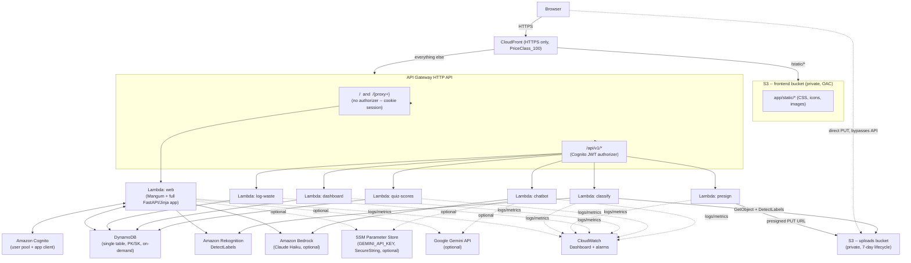

# Architecture (serverless deployment, `aws-deploy` branch)

`main` keeps running exactly as before: `uvicorn app.main:app` on localhost.
This document describes the separate, self-contained stack that
`infra/template.yaml` deploys via `scripts/deploy.sh` -- its own Cognito
user pool, its own DynamoDB table, its own data. Nothing here changes how
`main` behaves.

## Why a "web" Lambda *and* a JSON API

Haraa is a server-rendered FastAPI + Jinja app with cookie-based sessions --
not a single-page app that talks to a JSON backend. Rewriting all ~20 pages
into a SPA was out of scope for this phase, so the deployment takes a
**pragmatic lift**: the entire existing app runs, basically unchanged, as
one Lambda behind API Gateway (same session-cookie login as localhost). A
second, smaller surface -- `/api/v1/*`, protected by a real Cognito JWT
authorizer -- covers the five functions the brief called out by name
(classify, log waste, dashboard data, quiz scores, chatbot) plus upload
presigning, as a genuine API for future API/mobile clients. The Cognito ID
token used there is the exact same one `app/routers/auth.py` already stores
in the session at login (`request.session["id_token"]`), now also exposed
to page templates (`app/templating.py`) as `api_id_token` so client-side JS
can call it with `Authorization: Bearer <token>`.

## Diagram



## Request flow: photo upload (the JSON API path)

1. Browser calls `POST /api/v1/uploads/presign` (JWT) -> gets `{upload_url, key}`.
2. Browser `PUT`s the image bytes directly to S3 using `upload_url` (never
   touches API Gateway/Lambda -- avoids the 6 MB HTTP API payload limit and
   keeps Lambda out of the data path entirely).
3. Browser calls `POST /api/v1/classify` with `{key}` (JWT). The classify
   Lambda calls Rekognition `DetectLabels` with `Image.S3Object` pointing at
   that key -- no bytes flow through Lambda here either.
4. Browser calls `POST /api/v1/waste-events` to log the result (JWT).
5. The object in S3 expires automatically after 7 days (bucket lifecycle
   rule), regardless of whether step 4 happened.

The server-rendered `/upload` page (used when you're just browsing the
site normally) still works exactly like localhost: multipart form POST,
image bytes flow through the web Lambda, Rekognition is called with
`Image.Bytes` directly (`app/services/rekognition_service.py`, unchanged).
The only behavior change there is `LOCAL_ML_ENABLED=false`
(`app/routers/upload.py`): the local PyTorch model isn't shipped to Lambda
in this phase, so it skips straight to the same Rekognition fallback path
that already exists locally.

## Lambda build -- no Docker

`fastapi` (via `pydantic`/`pydantic-core`, a compiled Rust extension) and
`Pillow` can't be `pip install`ed on macOS and run on Lambda's Amazon Linux
-- but they don't need Docker either. `Makefile` (repo root, invoked by
`sam build` via each resource's `Metadata: BuildMethod: makefile`)
cross-installs prebuilt wheels:

```
pip install -r requirements-lambda.txt \
  --platform manylinux2014_x86_64 --only-binary=:all: --python-version 3.12 \
  --target <artifacts>/python
```

This becomes one shared Lambda **Layer** (`WebDepsLayer`), used by exactly
two functions: `web` (the full app) and `chatbot` (needs `google-genai`).
The other four `/api/v1/*` functions (classify, presign, log-waste,
dashboard, quiz-scores) need **no layer at all** -- they're pure stdlib
plus the `boto3`/`botocore` already preinstalled in the Lambda Python 3.12
runtime, calling only long-stable services (S3, DynamoDB, Rekognition).
`torch`/`torchvision`/`pillow-heif` are not in `requirements-lambda.txt` at
all; the local ML model stays a `main`-branch-only, localhost-only feature
for now.

## What's deliberately *not* here

- No NAT gateway, no VPC, nothing that runs or costs money while idle.
- No REST API (HTTP API is cheaper and has native JWT-authorizer support).
- No provisioned-capacity DynamoDB (on-demand, same as `scripts/setup_aws.py`).
- No custom domain / ACM certificate -- the default `*.cloudfront.net`
  HTTPS URL is used as-is, to keep this reproducible with one command and
  zero DNS setup.
- HEIC upload support through `/api/v1/classify` (no `pillow-heif` in the
  Lambda layer) -- JPEG/PNG/WebP only. The server-rendered `/upload` page's
  Pillow-based normalization still has HEIC support since it *does* ship
  Pillow (just not `pillow-heif`, for the same reason) -- actually, per the
  build above, `pillow-heif` is excluded from the layer entirely, so HEIC
  is unsupported in **both** paths once deployed; it still works locally.
